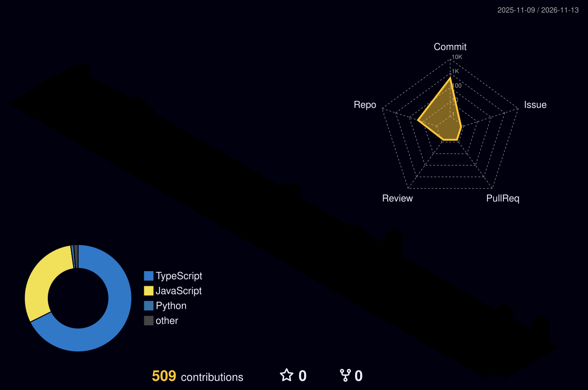

<!-- Animated gradient header -->

  

<!-- Typing animation -->

  

  
  
  

##  About me

I build web apps and online stores, and I also run the marketplace side of ecommerce, so I know what a store needs after launch day.

<table>
  <tr>
    <td width="50%" valign="top">
      <h3 align="center"> Full Stack Web Developer</h3>
      <ul>
        <li>Web apps with React, Next.js, Vue and Nuxt.js</li>
        <li>APIs and backends with Node.js and Express</li>
        <li>Stores and sites on Shopify and WordPress</li>
        <li>AI-powered apps built with Claude and Supabase</li>
      </ul>
    </td>
    <td width="50%" valign="top">
      <h3 align="center"> Ecommerce Marketplace Manager</h3>
      <ul>
        <li>Vendor onboarding for US brands</li>
        <li>Product spec files and listings</li>
        <li>Order fulfillment and daily operations</li>
        <li>Custom automations and systems that make marketplace work faster</li>
        <li>Amazon, Target, Nordstrom, Macy's and more</li>
      </ul>
    </td>
  </tr>
</table>

##  Tech stack

<h4 align="center">Frontend</h4>

  

<h4 align="center">Backend and databases</h4>

  

<h4 align="center">Ecommerce, CMS and AI</h4>

  
  
  

<h4 align="center">Marketplaces</h4>

  
  
  
  
  
   
  
  
  
  

##  GitHub stats

<!-- 3D contribution graphic: generated inside this repo by the profile.yml workflow -->

  

  

<!-- Contribution snake: appears after the profile.yml workflow has run once -->

  <picture>
    <source media="(prefers-color-scheme: dark)" srcset="https://raw.githubusercontent.com/rohanr92/rohanr92/output/github-contribution-grid-snake-dark.svg" />
    
  </picture>

##  Let's work together

Open to full stack web development projects and ecommerce marketplace management work.

  

